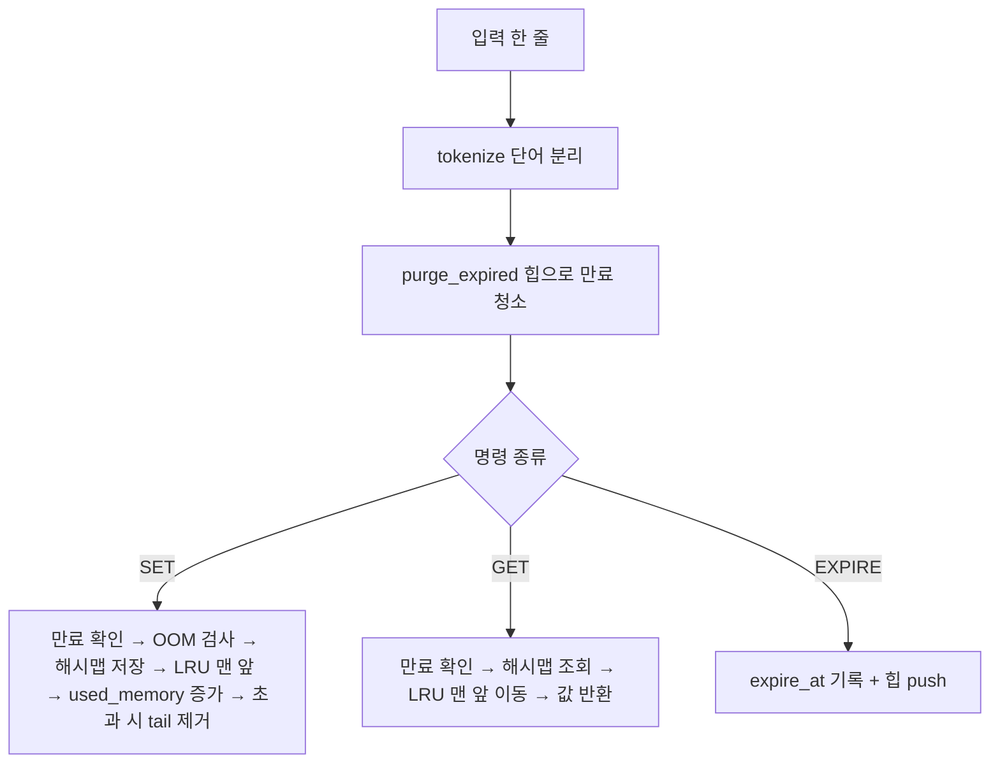

# 미션 5-1 개념 가이드 (기초 → 상세 → 쉬운 설명)

## 0. 한눈에 보는 개념 순서 리스트
1. 메모리 / 배열(고정 길이 칸) / 포인터(주소로 가리키기)
2. 시간 복잡도 Big-O (`O(1)`, `O(log n)`, `O(n)`)
3. 이중 연결 리스트
4. 해시 함수 → 해시맵 → 충돌 → 체이닝 → 로드 팩터와 리사이즈
5. 완전 이진 트리 → 최소 힙
6. 캐시와 LRU
7. TTL(만료)과 lazy deletion
8. Redis 스타일 명령/에러/REPL
9. 전체 조립: 한 번의 `SET`, `GET`이 거치는 길

---

## 1. 메모리 · 배열 · 포인터
- **상세**: 배열은 같은 크기 칸이 연속으로 붙어 있어 `a[i]`로 번호만 알면 즉시 접근(O(1))한다. 포인터(참조)는 "다른 데이터가 있는 위치"를 적어 둔 값이다.
- **쉬운 설명**: 배열은 **번호 붙은 사물함**, 포인터는 **"○○ 사물함에 있어요"라고 적힌 쪽지**.

## 2. 시간 복잡도 Big-O
- **상세**: 데이터가 n개일 때 작업 횟수가 어떻게 늘어나는지 표현. `O(1)` 항상 일정, `O(log n)` 1000배 늘어도 약 10번 정도만 증가, `O(n)` 데이터만큼 증가.
- **쉬운 설명**: 친구 집 찾기. `O(1)`=주소를 알아서 바로 감, `O(n)`=동네 집을 하나씩 문 두드림.

## 3. 이중 연결 리스트
- **상세**: 노드마다 `prev`, `next`, `data`. 노드 참조만 있으면 앞뒤 노드의 포인터 2~4개만 바꿔 삽입/삭제/이동이 **O(1)**. (단, "n번째 찾기"는 O(n) → 그래서 해시맵과 조합)
- **쉬운 설명**: **손잡고 선 줄**. 가운데 사람이 빠져도 양옆 사람이 손만 다시 잡으면 된다.
- **코드**: `mini_redis/linked_list.py`

## 4. 해시맵 (체이닝)
- **해시 함수**: 키(문자열) → 숫자. 같은 키는 항상 같은 숫자. 이 프로젝트는 djb2(`h = h*33 + 글자`).
- **버킷 번호** = `해시값 % 버킷수`. 번호만 알면 곧바로 그 칸으로 → 평균 O(1).
- **충돌**: 서로 다른 키가 같은 칸에 배정되는 일. **체이닝**은 칸 안에 리스트를 만들어 줄 세워 해결.
- **로드 팩터** = `항목수 / 버킷수`. 0.75 초과 시 칸이 붐벼 체인이 길어지므로 **버킷 2배 + 전원 재배치(rehash)**. (칸 수가 바뀌면 `% 버킷수` 결과도 바뀌므로 재배치 필수)
- **쉬운 설명**: **아파트 우편함**. 이름 → 호수 규칙이 해시 함수, 같은 호에 여럿이면 한 우편함에 줄 세우기(체이닝), 너무 붐비면 동 증축 후 전원 이사.
- **코드**: `mini_redis/hashmap.py`

## 5. 힙 (최소 힙)
- **완전 이진 트리**: 위에서 아래, 왼쪽에서 오른쪽으로 빈틈없이 채운 트리 → **배열**로 표현 가능. 부모 `(i-1)//2`, 자식 `2i+1`, `2i+2`.
- **최소 힙 규칙**: 부모 ≤ 자식 → 루트가 항상 최솟값.
- `push`: 끝에 넣고 `_heapify_up`(부모보다 작으면 위로). `pop`: 루트를 꺼내고 마지막을 루트에 놓아 `_heapify_down`(더 작은 자식과 교환). 둘 다 O(log n), `peek` O(1).
- **TTL에 적합한 이유**: 필요한 건 "가장 빨리 만료될 키" 하나뿐. 전체 정렬은 낭비, 힙은 맨 위만 O(1)로 확인.
- **쉬운 설명**: **유통기한 임박순 냉장고**. 맨 위 음식만 보면 먼저 먹을 것을 안다.
- **코드**: `mini_redis/heap.py`

## 6. 캐시와 LRU
- **캐시**: 자주 쓰는 데이터를 빠른 곳에 잠깐 보관. 공간이 한정되어 **무엇을 버릴지** 정책이 필요.
- **LRU(Least Recently Used)**: 가장 오래 사용하지 않은 것부터 버림.
- **O(1) LRU = 해시맵 + 이중 연결 리스트**
  - 해시맵: 키 → Entry(안에 리스트 노드 주소) 로 O(1) 조회
  - 리스트: 노드를 맨 앞으로 이동 O(1), 제거 대상은 맨 뒤(tail) O(1)
- **쉬운 설명**: 책상이 좁아서 책을 다 못 올릴 때, 방금 본 책은 맨 위에 두고 **맨 아래 책부터 서랍으로 치우기**.
- **used_memory**: `Σ(len(utf8(key)) + len(utf8(value)))`. 예) `user:1`(6)+`Alice`(5)=11… (한글 등은 UTF-8 바이트 수)

## 7. TTL과 lazy deletion
- **TTL**: 키의 남은 수명(초). `EXPIRE key N`으로 설정, `TTL key`로 조회 (없는 키 -2, 만료 없음 -1).
- **lazy deletion**: 덮어쓰기/삭제로 키의 만료가 바뀌어도 힙 안의 옛 항목을 억지로 찾아 지우지 않는다. 나중에 `pop`했을 때 "현재 만료시각과 같은가?"를 비교해 다르면 버린다. (힙 중간 삭제는 비싸기 때문)
- **쉬운 설명**: 냉장고 알림판에 옛 메모가 남아 있어도, 실제 음식을 확인해 **이미 먹은 음식이면 메모만 버린다**.

## 8. Redis 스타일 CLI
- **REPL**: Read(읽기) → Eval(실행) → Print(출력) → Loop(반복).
- 출력 규칙: `OK`, `(nil)`, `(integer) N`, `(error) ...`, 목록은 `1. "a"`.
- 따옴표 값: `SET name "Kim Min"` → 공백 포함 값을 한 덩어리로.

## 9. 전체 조립: 한 번의 요청이 가는 길

---

## 10. 3초 복습 퀴즈
1. Q. 이중 연결 리스트에서 중간 노드 삭제가 O(1)인 이유? → A. 앞뒤 노드 포인터만 바꾸면 되고 노드 참조를 이미 알기 때문.
2. Q. 로드 팩터 0.75 초과 시 하는 일? → A. 버킷 2배 확장 + 전체 rehash.
3. Q. LRU가 O(1)인 이유? → A. 해시맵으로 노드를 찾고, 리스트로 이동/제거를 O(1)에 처리.
4. Q. TTL에 힙을 쓰는 이유? → A. 가장 빨리 만료될 키를 맨 위에서 O(1)로 확인.
5. Q. 존재하는 키를 GET하면 LRU는? → A. 맨 앞으로 이동(갱신). 만료로 삭제되면 갱신하지 않음.
